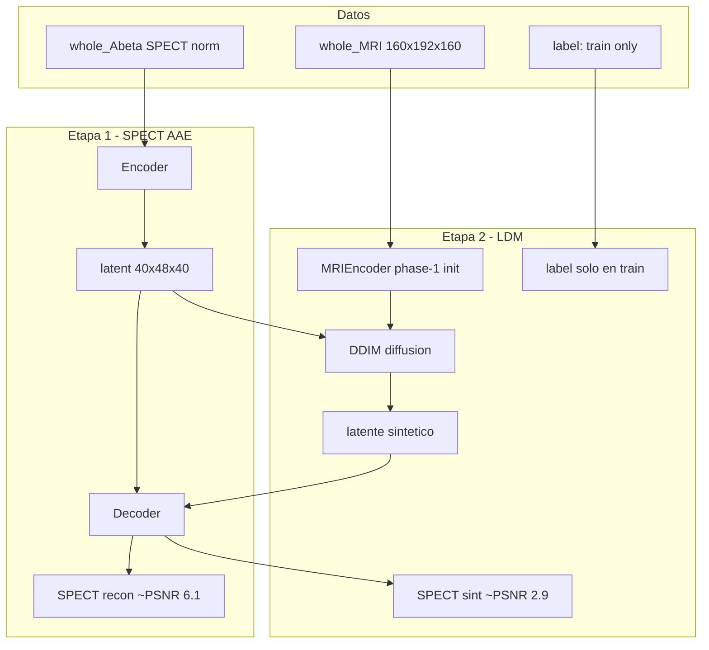

# Reporte general del proyecto IL-CLDM (cohorte fsierra)

**Fecha de generación:** 2026-05-25  
**Alcance:** datos disponibles, estadísticas por población y modalidad, diagnóstico de la reconstrucción/síntesis SPECT, y recomendaciones de mejora alineadas con las decisiones del investigador.

---

## 1. Resumen ejecutivo

El repositorio implementa **Image-and-Label Conditioning Latent Diffusion Model (IL-CLDM)** para síntesis de imágenes funcionales a partir de MRI. El artículo original apunta a **Aβ-PET**; la cohorte activa (**fsierra**) usa pares **MRI + SPECT DaT** normalizados y coregistrados.

| Hallazgo | Valor / estado |
|----------|----------------|
| Cohorte | **187** sujetos emparejados (149 train / 38 test) |
| Poblaciones | Binarias: **control** (73) vs **parkinson** (114) |
| Autoencoder SPECT (etapa 1) | PSNR test ≈ **6.15**, SSIM ≈ **0.61** |
| Autoencoder MRI (phase-1) | PSNR test ≈ **6.53**, SSIM ≈ **0.53** |
| Síntesis MRI→SPECT (etapa 2 + inferencia) | PSNR ≈ **2.94**, SSIM ≈ **0.048** |
| Calidad visual | SPECT sintético tipo “blob”, sin detalle de uptake (ver sección 5) |

La síntesis funcional **no es coherente** con el target en la configuración actual (`exp_1`). El cuello de botella principal no es el tamaño del test, sino el **pipeline de difusión + decodificación** y el **condicionamiento MRI**.

---

## 2. Contexto del modelo y flujo de datos

### 2.1 Pipeline en dos etapas



| Etapa | Script principal | Entrada → salida |
|-------|------------------|------------------|
| Preparación | [`prepare_fsierra_data.py`](../prepare_fsierra_data.py) | NIfTI externos → symlinks en `data/whole_MRI`, `data/whole_Abeta` |
| 1 – SPECT AAE | [`main.py`](../main.py) `train_AAE` | SPECT → latente → recon SPECT |
| 1b – MRI AAE (phase-1) | [`code/run_phase1_mri_experiment.py`](../code/run_phase1_mri_experiment.py) | MRI → latente MRI (evaluación de embeddings) |
| 2 – LDM | [`main.py`](../main.py) `train_LDM` | MRI (+ label en train) → latente SPECT sintético → decode |
| Inferencia | [`inference.py`](../inference.py) | MRI **sin label** → SPECT sintético + métricas |

### 2.2 Fuente de datos

| Elemento | Ruta / detalle |
|----------|----------------|
| Origen crudo (workflow legacy) | Directorio configurado con `ILCLDM_SOURCE_ROOT` (ver `.env.example`) |
| MRI | `{split}_mri/{ID}_mri_norm.nii.gz` |
| SPECT | `{split}_spect/{ID}_spect_coregistered_norm.nii.gz` |
| Metadatos | [`data_info/data_info.csv`](../data_info/data_info.csv) |
| Mount en dev container | Ver [`DEVCONTAINER.md`](../DEVCONTAINER.md) |

**Nota:** En el workspace de desarrollo pueden faltar los NIfTI bajo `data/` (solo symlinks cuando se ejecuta `prepare_fsierra_data.py` con el volumen montado). Las estadísticas de intensidad/volumen a nivel voxel requieren acceso a esos archivos.

---

## 3. Datos y estadísticas por población

### 3.1 Variables de cohorte

El CSV de metadatos solo define:

| Campo | Descripción |
|-------|-------------|
| `ID` | Identificador del sujeto |
| `label` | `0` = control, `1` = parkinson |
| `split` | `train`, `validation` o `test` |

No hay edad, sexo ni centro en el repositorio.

### 3.2 Conteos por split y población

| Split | Total | Control | Parkinson | % Parkinson |
|-------|-------|---------|-----------|-------------|
| **train** | 149 | 58 | 91 | 61.1% |
| **test** | 38 | 15 | 23 | 60.5% |
| **Total** | **187** | **73** | **114** | 61.0% |

El conjunto de entrenamiento está **moderadamente desbalanceado** hacia parkinson.

### 3.3 Diseño de splits (decisión del proyecto)

- [`data_info/validation.txt`](../data_info/validation.txt) contiene **los mismos 38 IDs** que [`data_info/test.txt`](../data_info/test.txt).
- **Decisión:** mantener este diseño hasta obtener resultados coherentes; no se propone un hold-out adicional en esta fase.
- Split interno adicional: [`data_info/embedding_eval_split.csv`](../data_info/embedding_eval_split.csv) — 80/20 estratificado solo sobre **train**, para clasificación de embeddings (phase-1). No sustituye al test externo.

### 3.4 Modalidades y preprocesado

| Modalidad | Carpeta en repo | Resolución tras crop | Uso |
|-----------|-----------------|----------------------|-----|
| **MRI** | `data/whole_MRI` | 160×192×160 | Condicionamiento LDM; entrada phase-1 |
| **SPECT** | `data/whole_Abeta` (nombre legacy “Abeta”) | 160×192×160 | Target AAE y métricas de síntesis |
| **Latente** | `data/latent_Abeta`, `latent_MRI` | 1×40×48×40 | Espacio de difusión |
| **Aβ-PET (paper)** | Documentación ADNI | — | No usado en pipeline fsierra |

Preprocesado ([`dataset.py`](../dataset.py)):

- Crop fijo `[10:170, 18:210, 10:170]`.
- Entrenamiento SPECT etapa 1: traslación aleatoria ±2 voxels.
- Normalización min–max opcional: `ILCLDM_NORMALIZE=1` (por defecto desactivada).

### 3.5 Estadísticos pendientes (requieren NIfTI montados)

No generados en este reporte; recomendados para una siguiente iteración:

- Histogramas de intensidad por modalidad y split.
- Comprobación de coregistro MRI–SPECT (correlación local, overlay).
- Volumen de soporte cerebral / ROI estriatal para métricas regionales.

Tablas regenerables: `python scripts/generate_cohort_report.py` → [`docs/tables/generated_tables.md`](tables/generated_tables.md) y CSVs asociados.

---

## 4. Resultados por modalidad y etapa

### 4.1 Etapa 1 — Autoencoder SPECT (techo del pipeline)

Fuente: [`result/exp_1/test.csv`](../result/exp_1/test.csv) (bloque antes de métricas LDM).

| Métrica (test) | Valor aprox. |
|----------------|--------------|
| PSNR | **6.15** |
| SSIM | **0.61** |

Interpretación: el espacio latente **captura parte** de la estructura SPECT, pero ya con pérdida visible. Este techo limita cualquier etapa 2 que decodifique a través del mismo AAE.

### 4.2 Phase-1 — Autoencoder MRI

Fuente: [`result/exp_2/phase1_mri/`](../result/exp_2/phase1_mri/).

**Reconstrucción MRI→MRI (test):**

| Población | PSNR | SSIM | n |
|-----------|------|------|---|
| Control | 6.25 | 0.54 | 15 |
| Parkinson | 6.72 | 0.53 | 23 |
| **Global** | **6.53** | **0.53** | 38 |

**Clasificación sobre embeddings** (split interno 80/20 del train, [`classification_metrics.csv`](../result/exp_2/phase1_mri/embedding_analysis/classification/classification_metrics.csv)):

| Modelo | Balanced accuracy | ROC-AUC |
|--------|-------------------|---------|
| LogisticRegression | 0.49 | 0.32 |
| SVM (linear) | 0.49 | 0.32 |
| SVM (RBF) | 0.40 | 0.55 |
| DNN simple | 0.42 | 0.49 |

Los embeddings MRI **no separan** de forma fiable control vs parkinson (cerca del azar). Implicación: condicionar la difusión solo con este encoder no garantiza señal clínica fuerte, aunque sí aporta representación anatómica.

### 4.3 Etapa 2 — Síntesis MRI→SPECT (problema principal)

Fuente: [`result/exp_1/inference/20260508_160032/reconstruction_metrics.csv`](../result/exp_1/inference/20260508_160032/reconstruction_metrics.csv).

**Global (187 sujetos, train+test en inferencia):**

| PSNR | SSIM |
|------|------|
| **2.94** | **0.048** |

**Por split y población:**

| Split | Población | PSNR | SSIM | n |
|-------|-----------|------|------|---|
| train | control | 2.87 | 0.042 | 58 |
| train | parkinson | 3.02 | 0.049 | 91 |
| test | control | 2.84 | 0.044 | 15 |
| test | parkinson | 2.85 | 0.060 | 23 |

No hay mejora sustancial en test respecto a train ni diferencia clínica clara entre grupos: el fallo es **global del modelo**, no solo generalización.

### 4.4 Tabla resumen

| Etapa | Entrada → salida | PSNR | SSIM | ¿Útil clínicamente? |
|-------|------------------|------|------|---------------------|
| SPECT AAE | SPECT → SPECT | ~6.1 | ~0.61 | Recon parcial |
| MRI AAE (phase-1) | MRI → MRI | ~6.5 | ~0.53 | Embeddings no discriminativos |
| LDM + decode | MRI → SPECT | **~2.9** | **~0.05** | **No** |

---

## 5. Diagnóstico de la mala reconstrucción visual

Las imágenes sintéticas (ej. sujetos 3165/3172 control, 3107 parkinson) muestran regiones brillantes amorfas, sin patrón de uptake ni anatomía fina. Esto es coherente con PSNR ≈ 3 y SSIM ≈ 0.05.

### 5.1 Causas técnicas priorizadas

1. **Cuello de botella latente** — Compresión ~8× y `latent_dim=1` ([`config.py`](../config.py)); errores en latente se amplifican al decodificar ruido difundido.

2. **Objetivo de entrenamiento desacoplado de la imagen final** — Etapa 2 solo minimiza MSE del ruido en `40×48×40` ([`main.py`](../main.py)); no optimiza el SPECT decodificado (ver mejora A4).

3. **Uso del label (diseño acordado)** — En **entrenamiento** se usa `label` en el UNet; en **inferencia** no ([`inference.py`](../inference.py)). Es el comportamiento clínico correcto. Si el modelo aprende a depender demasiado de `label_emb` ([`model.py`](../model.py)), la síntesis sin label puede degradarse; mitigación futura opcional en train (label dropout), **sin** usar label en inferencia.

4. **Condicionamiento MRI** — `exp_1` usó `DiffusionConditioner` ligero; phase-1 entrenó un `MRIEncoder` más rico, pero no se ha comparado de forma sistemática **encoder congelado vs fine-tune** con el mismo checkpoint (mejora A2).

5. **Dominio SPECT vs PET del paper** — Cambio de modalidad y fisiología; los nombres `Abeta` / `whole_Abeta` pueden ocultar el desajuste conceptual.

6. **Métricas globales** — PSNR/SSIM en todo el volumen son poco sensibles al patrón de uptake en striatum.

7. **Mismo fallo en train y test** — Descarta que el problema sea solo overfitting al split de 38 test.

---

## 6. Recomendaciones de mejora (backlog)

### 6.1 Decisiones fijas del investigador

| Tema | Decisión |
|------|----------|
| **A1 – Label** | Solo en **entrenamiento** LDM. **Nunca** en inferencia ni evaluación desplegable. |
| **A3 – Splits** | Mantener `validation == test` hasta resultados coherentes. |

### 6.2 Prioridad alta

#### A1 — Label solo en entrenamiento

| Fase | Uso de `label` |
|------|----------------|
| Train (`main.py`, `train_LDM`) | **Sí** — `Unet(x_t, MRI_cond, t, label)` |
| Validación / test en pipeline | **No** — alineado con inferencia clínica |
| `inference.py` | **No** — solo MRI (mantener explícito) |

#### A2 — MRI encoder: comparar congelado vs fine-tune (bandera)

Inicialización común: checkpoint phase-1  
`result/exp_2/phase1_mri/checkpoints/MRI_AAE.pth.tar`

| Modo | Variable de entorno | Comportamiento |
|------|---------------------|----------------|
| **A – Congelado** | `ILCLDM_FREEZE_MRI_ENCODER=1` | Encoder en `eval()`, sin gradientes ([`main.py`](../main.py)) |
| **B – Fine-tune** | `ILCLDM_FREEZE_MRI_ENCODER=0` | Encoder en optimizador (LR menor que UNet recomendado) |

Ejemplo de dos corridas (cambiar `exp` en [`config.py`](../config.py) para separar resultados, p. ej. `exp_frozen/` y `exp_finetune/`):

```bash
# Modo A — encoder congelado
ILCLDM_FREEZE_MRI_ENCODER=1 \
ILCLDM_MRI_ENCODER_CHECKPOINT=result/exp_2/phase1_mri/checkpoints/MRI_AAE.pth.tar \
python main.py

# Modo B — encoder fine-tune
ILCLDM_FREEZE_MRI_ENCODER=0 \
ILCLDM_MRI_ENCODER_CHECKPOINT=result/exp_2/phase1_mri/checkpoints/MRI_AAE.pth.tar \
python main.py
```

El reporte comparativo debe incluir PSNR/SSIM e imágenes lado a lado para ambos modos.

#### A4 — Pérdida auxiliar en imagen decodificada

**Problema:** `L_noise = MSE(ε_pred, ε_true)` no observa el SPECT final.

**Flujo de evaluación real:**

```text
x_t → UNet predice ε → DDIM → x̂_0 → decoder(SPECT AAE) → volumen 160×192×160
```

**Propuesta:**

1. Estimar `x̂_0` a partir de `x_t`, `t` y `ε_pred`.
2. `ŷ = decoder(x̂_0)` con decoder SPECT **congelado** al inicio.
3. `L_img = L1(ŷ, SPECT_gt) + λ · (1 - SSIM(ŷ, SPECT_gt))`.
4. `L = L_noise + α · L_img`, con `α` pequeño (0.01–0.1) y warmup.

**Beneficio esperado:** gradiente hacia latentes que decodifiquen en estructuras visibles, no solo ruido compatible en 40³.

**Cuidados:** coste GPU (aplicar cada N batches); no subir `α` demasiado rápido; validar primero `L_img` solo en validación sin backprop.

### 6.3 Prioridad media

| ID | Acción |
|----|--------|
| B1 | Aumentar capacidad latente (`latent_dim`, menos downsampling) |
| B2 | QC de pares MRI–SPECT (coregistro, outliers) |
| B3 | Balanceo de clases en train (`WeightedRandomSampler`) |
| B4 | Métricas en ROI (striatum) además de PSNR global |

### 6.4 Prioridad baja

| ID | Acción |
|----|--------|
| C1 | Baselines de literatura adaptadas a SPECT |
| C2 | Ajuste fino de pasos DDIM / schedule |
| C3 | Metadatos demográficos si existen fuera del repo |

---

## 7. Anexo — Reproducibilidad

### 7.1 Regenerar tablas

```bash
python scripts/generate_cohort_report.py
# Salida: docs/tables/generated_tables.md y CSVs asociados
```

### 7.2 Comandos útiles

```bash
# Preparar datos (requiere mount fsierra)
python prepare_fsierra_data.py

# Phase-1 MRI
python code/run_phase1_mri_experiment.py --exp exp_2

# Pipeline principal
python main.py

# Inferencia + SPECT sintético
python inference.py --exp exp_1 --save-synthetic-spect

# Figuras exploratorias
# run.ipynb
```

### 7.3 Archivos clave

| Tema | Archivos |
|------|----------|
| Datos | `data_info/data_info.csv`, `prepare_fsierra_data.py`, `dataset.py` |
| Modelo | `model.py`, `config.py`, `main.py` |
| Phase-1 | `code/run_phase1_mri_experiment.py` |
| Inferencia | `inference.py` |
| Métricas síntesis | `result/exp_1/inference/20260508_160032/reconstruction_metrics.csv` |
| Métricas phase-1 | `result/exp_2/phase1_mri/` |

---

## 8. Conclusión

El proyecto dispone de una cohorte **187 sujetos** con pares MRI–SPECT y etiquetas binarias control/parkinson, con un pipeline IL-CLDM completo en código. Los autoencoders por modalidad alcanzan reconstrucciones moderadas (~6 PSNR), pero la **síntesis cross-modal MRI→SPECT falla** de forma severa (~3 PSNR, SSIM ~0.05), en línea con imágenes sintéticas sin estructura clínica.

Las mejoras prioritarias acordadas son: **(A1)** mantener label solo en train; **(A2)** comparar encoder MRI congelado vs fine-tune vía `ILCLDM_FREEZE_MRI_ENCODER`; **(A3)** conservar splits actuales; **(A4)** añadir pérdida en imagen decodificada para alinear optimización con la calidad visual.
