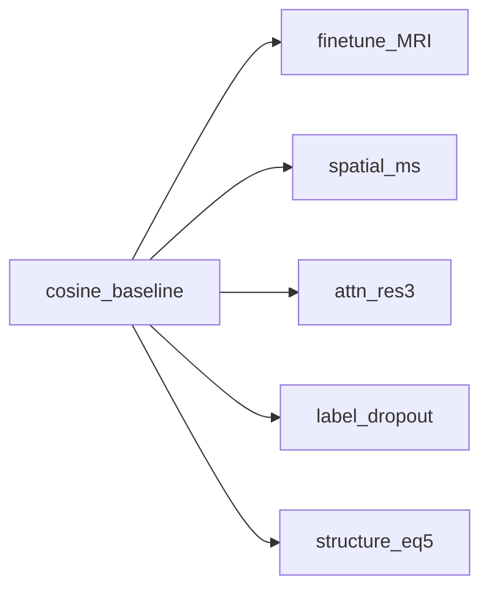

# Ablaciones independientes sobre minmax_kl_cosine

## Decisiones fijadas

- **Padre:** `calib_roi3ch_uni_rois_reproc_x0_minmax_kl_cosine` (checkpoint ya en `result/exp_nm_s2_frozen_…_minmax_kl_cosine/`; clave re-registrada en [`experiments/registry.json`](../experiments/registry.json)).
- **Diseño:** 5 hermanos, UNet scratch, un solo override cada uno; todos heredan `ILCLDM_LR_SCHEDULER=cosine` + resto del padre.
- **Sin R5b** (recon brazo MRI→SPECT).
- **Structure loss** = paper CycleGAN MRI↔SPECT eq. 5 (p. 4):

\[
L_{\mathrm{structure}} = 1 - \mathrm{SSIM}(y,\hat{y})
\]

  Misma forma que el SSIM de R4/PASTA; flag y clave propios (`STRUCTURE_LOSS_LAMBDA`) para trazabilidad CycleGAN. No apilar con `DIFFUSION_SSIM_LAMBDA` en la misma corrida.
- **Atención ROI:** latente `24×28×29` → resoluciones UNet `24→12→6→3`. Override `ILCLDM_ATTN_RES=3` (no `5`: no añade bloques).
- **Construcción:** código + registry + docs + tests. Lanzamiento manual vía `nohup` (ver RUNBOOK).



## Base vs Padre (no son competidores)

En el registry hay **dos campos distintos**; solo el Padre es la línea base científica.

| Campo | Qué es | Ejemplo | ¿Entrena / checkpoint UNet? |
| --- | --- | --- | --- |
| **`base`** | Plantilla de **env compartido**: paths AAE, latentes, ROI shape, minmax, KL, etc. Evita copiar 15 flags en cada clave. | `base_calib_roi3ch_uni_rois_reproc_minmax_kl` | No. No es un experimento a batir. |
| **`parent`** | Experimento **ya entrenado** contra el que se mide el delta (linaje + comparación). | `…_x0_minmax_kl_cosine` | Sí. Es tu línea base ganadora en clasificación. |

`run_ablation` hace: `env = registry[base]` ∪ `overrides`, y solo anota `ILCLDM_PARENT_EXPERIMENT=parent` en el manifest. **No** carga pesos del padre (salvo `init_checkpoint` explícito; aquí UNet scratch).

Por eso el **Padre es cosine** (mejores resultados de clasificación): las 5 ablaciones se interpretan como *cosine + un cambio*. El `base_…_minmax_kl` solo dice “mismos datos/AAE que esa familia”; no sustituye a cosine como referencia de métricas.

## Claves registry (un delta)

- `base` de todos: `base_calib_roi3ch_uni_rois_reproc_minmax_kl` (paths/datos).
- `parent` de todos: `…_x0_minmax_kl_cosine` (línea base a superar/comparar).
- Overrides del padre cosine: `x0` + `EARLY_STOP_LATENT` + `PRED_X0_CLAMP=4` + `LR_SCHEDULER=cosine` + `BATCH_SIZE=8`.
- Cada hijo: esos mismos overrides **más un solo delta**.

| Clave | Override único (delta) |
| --- | --- |
| `…_cosine_ft` | `ILCLDM_MRI_ENCODER_MODE=finetune` |
| `…_cosine_film_ms` | `ILCLDM_FILM_MODE=spatial_ms` (UNet scratch) |
| `…_cosine_film_ms_ws` | mismo FiLM + `init_checkpoint` cosine UNet (vs scratch) |
| `…_cosine_attn3` | `ILCLDM_ATTN_RES=3` |
| `…_cosine_label_drop` | `ILCLDM_LABEL_DROPOUT_PROB=0.15` |
| `…_cosine_structure` | `ILCLDM_STRUCTURE_LOSS_LAMBDA=1.0` |

Exps: `exp_nm_s2_{frozen|finetune}_calib_…` alineados al modo MRI.

## Código

1. **[`config.py`](../config.py)** — `LR_SCHEDULER` (`none`\|`cosine`); `STRUCTURE_LOSS_LAMBDA` (default `0`).
2. **[`main.py`](../main.py)** — `CosineAnnealingLR` si cosine; structure vía `ssim_loss_3d` (prioridad sobre `DIFFUSION_SSIM_LAMBDA`).
3. **[`utils.py`](../utils.py)** — flags en `RUN_MANIFEST_CONFIG_KEYS`.
4. **[`experiments/registry.json`](../experiments/registry.json)** — padre cosine + 5 hijos.
5. **Tests:** [`tests/test_cosine_ablations.py`](../tests/test_cosine_ablations.py).
6. **Docs:** [`RUNBOOK.md`](../RUNBOOK.md) § «Ablaciones independientes sobre minmax_kl_cosine»; [`plan-ablation-pasta-diffusion.md`](plan-ablation-pasta-diffusion.md).

```bash
# Sustituir N por el índice CUDA visible en el contenedor (p. ej. 0 si solo hay una GPU)
setsid nohup bash -c '
  for k in \
    calib_roi3ch_uni_rois_reproc_x0_minmax_kl_cosine_ft \
    calib_roi3ch_uni_rois_reproc_x0_minmax_kl_cosine_film_ms \
    calib_roi3ch_uni_rois_reproc_x0_minmax_kl_cosine_attn3 \
    calib_roi3ch_uni_rois_reproc_x0_minmax_kl_cosine_label_drop \
    calib_roi3ch_uni_rois_reproc_x0_minmax_kl_cosine_structure
  do
    python3 scripts/run_ablation.py "$k" --gpu N || exit 1
  done
' > logs/ablate_cosine5_gpuN.log 2>&1 < /dev/null &
```

## Fuera de alcance

- Inferencia automática post-train.
- R5b recon condicional, ROI×10, stack acumulativo.
- Cambiar baseline a `cosine_ssim` (structure se mide vs cosine puro).

## Nota

`…_cosine_ssim` ya entrenó `(1−SSIM)` PASTA. `…_cosine_structure` es el hermano CycleGAN eq.5; matemáticamente equivalente, clave/flag distintos. Si al lanzar quieres omitir structure por solape, se quita solo esa clave del loop.
