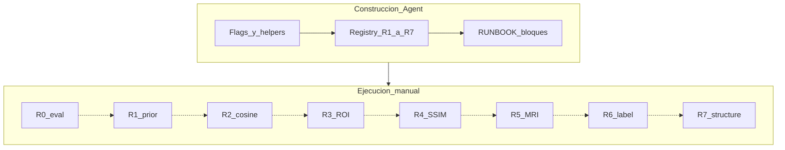

# Plan: código completo + ejecución R bajo demanda

## Respuesta a la pregunta

Sí. El flujo se parte en dos capas:

1. **Construcción (este plan al ejecutar en Agent):** implementar flags, tests, claves en [experiments/registry.json](../experiments/registry.json) y comandos documentados. **No** entrenar ni encadenar R0→R7.
2. **Ejecución (operador, cuando convenga):** lanzar un solo bloque R, mirar métricas, decidir si el siguiente acumula ese delta.

Vista global siempre en docs/registry; cada R es un comando independiente (`run_ablation`, fase1, o inferencia). No habrá un script que dispare R0–R7 seguidos.



Defaults de código: flags nuevos en **off / 0** para no alterar el baseline `…_x0_minmax_kl` hasta que una clave registry los encienda. Así no hay conflicto entre preparar todo y seguir ejecutando el stack actual.

---

## Capa A — Construcción (una sola pasada de código)

Baseline de referencia: `calib_roi3ch_uni_rois_reproc_x0_minmax_kl`.

### A1. Flags y helpers (todos a la vez)

| Flag | Default | Efecto cuando se activa |
| --- | --- | --- |
| `ILCLDM_GRAD_CLIP_NORM` | `0` (off) | `clip_grad_norm_` en UNet (y AAE si se reutiliza el mismo helper) |
| `ILCLDM_LR_SCHEDULER` | `none` | `cosine` → `CosineAnnealingLR` solo fase 2 |
| `ILCLDM_PRED_X0_CLAMP_LO/HI` | ya existen | helper escribe percentiles p0.5/p99.5 del latente train |
| `ILCLDM_SAMPLING_T_MAX` | ya existe (`990`) | override `999` solo en claves nuevas / R0 |
| `ILCLDM_DIFFUSION_ROI_WEIGHT` | `0` (off) | L1 `x0` ponderada; ROI latente ×N |
| `ILCLDM_DIFFUSION_SSIM_LAMBDA` | `0` (off) | `λ(1−SSIM)` en SPECT decodificado si objetivo `x0` (ablación R4; ver [plan-r4-ssim-image-loss.md](plan-r4-ssim-image-loss.md), λ PASTA = 1.0) |
| Recon brazo MRI | off | peso tipo PASTA ~0.1; solo claves R5 |
| `LABEL_DROPOUT_PROB` | ya existe (`0`) | R6 solo sube el override |
| `ILCLDM_STRUCTURE_LOSS_LAMBDA` | `0` (off) | R7: paper eq. 5 \(L_{\mathrm{structure}}=1-\mathrm{SSIM}\); si >0 se usa **en lugar de** `DIFFUSION_SSIM_LAMBDA` (sin doble conteo) |

Archivos: [config.py](../config.py), [main.py](../main.py), [utils.py](../utils.py), [dataset.py](../dataset.py) (percentiles), [losses/ssim.py](../losses/ssim.py), tests en `tests/`. Inferencia ya respeta clamp vía `_clamp_x0` / `SAMPLING_T_MAX`.

### A2. Registry: todas las claves listas, ninguna corrida

Crear (sin ejecutar):

- Base `base_…_minmax_kl1e1` + exps fase1 documentados: `exp_nm_s1_spect_rois_reproc_minmax_kl1e1`, `exp_nm_s1_mri_rois_reproc_minmax_kl1e1`
- `calib_roi3ch_uni_rois_reproc_x0_minmax_kl1e1` — R1c: x0 + clip + t_max=999 + clamp LO/HI (placeholders o path a stats tras encode)
- `…_minmax_kl_cosine` — R2 (**línea base de clasificación** actual; `LR_SCHEDULER=cosine`)
- `…_minmax_kl_roiw10` — R3 (**parent = `…_x0_minmax_kl`**; un solo delta `DIFFUSION_ROI_WEIGHT=10`)
- `…_minmax_kl_ssim` — R4 (**parent = `…_x0_minmax_kl`**; `DIFFUSION_SSIM_LAMBDA=1.0` PASTA; doc: [plan-r4-ssim-image-loss.md](plan-r4-ssim-image-loss.md))
- **Ola post-cosine (hermanos independientes, parent = `…_x0_minmax_kl_cosine`):**
  - `…_cosine_ft` — `MRI_ENCODER_MODE=finetune`
  - `…_cosine_film_ms` — `FILM_MODE=spatial_ms` (sin R5b recon brazo MRI)
  - `…_cosine_attn3` — `ATTN_RES=3` (grid latente ROI 24→…→3; no usar `5`)
  - `…_cosine_label_drop` — `LABEL_DROPOUT_PROB=0.15`
  - `…_cosine_structure` — `STRUCTURE_LOSS_LAMBDA=1.0` (CycleGAN eq. 5 \(1-\mathrm{SSIM}\); **no apilar** con `DIFFUSION_SSIM_LAMBDA`)

**Parent fijo (actualizado):** R2/R3/R4 cuelgan de `…_x0_minmax_kl`. Tras R2 cosine como baseline de clasificación, la ola conditioning/hygiene cuelga de **cosine** con un delta cada una (UNet scratch). `base_…_minmax_kl` solo aporta paths/AAE; no es el competidor de métricas.

### A3. Documentación de bloques (vista global + comandos)

En [RUNBOOK.md](../RUNBOOK.md) y §12 de [comparacion-difusion-pasta.md](comparacion-difusion-pasta.md):

- Tabla R0–R7: delta, prerequisito en disco, comando exacto, criterio de éxito
- Aviso explícito: **no** hay pipeline que ejecute todos los R
- Copia de referencia del plan en el repo (este archivo)

---

## Capa B — Ejecución manual por bloque

Criterio entre bloques: MSE latente val bajo “predecir la media”; PSNR/SSIM (y ROI) no peores que el padre. Si empeora, no usar ese delta como base del siguiente.

### R0 — Sampler (eval)

- Prereq: checkpoint `…_x0_minmax_kl`
- Acción: helper percentiles + inferencia A/B (LO/HI + `t_max=999` vs actual)
- Comando tipo: script/notebook de inferencia con env; **0 reentrenos**

### R1 — Prior KL 1e-1 + clip

- R1a/b: entrenar AAE SPECT/MRI con `KL_LAMBDA=1e-1` (vía `scripts/run_experiment.sh` / `run_phase1_mri_experiment.py`)
- Encode → `data_rois/latent_Abeta_minmax_kl1e1/` + stats + LO/HI
- R1c: `python3 scripts/run_ablation.py calib_roi3ch_uni_rois_reproc_x0_minmax_kl1e1 --gpu N`

### R2 / R3 / R4 — Un delta cada uno

```bash
python3 scripts/run_ablation.py <clave_R2|R3|R4> --gpu N
# R4 (SSIM imagen, λ=1.0): ver docs/plan-r4-ssim-image-loss.md
python3 scripts/run_ablation.py calib_roi3ch_uni_rois_reproc_x0_minmax_kl_ssim --gpu N
```

Solo cuando el usuario lo decida y tras mirar el padre. R2–R4 son hermanos sobre `…_x0_minmax_kl` (R2 cosine = baseline clasificación; R3/R4 evaluados aparte).

### Ola sobre cosine (ft / film_ms / attn3 / label_drop / structure)

Cinco claves independientes; ver tabla en [RUNBOOK.md](../RUNBOOK.md) § «Ablaciones independientes sobre minmax_kl_cosine». Structure = CycleGAN eq. 5; criterio vs padre cosine: PSNR/SSIM (y ROI) / clasificación no peores; DDIM estable.

```bash
python3 scripts/run_ablation.py calib_roi3ch_uni_rois_reproc_x0_minmax_kl_cosine_structure --gpu N
```

---

## Qué hace Agent mode al “construir el plan”

Incluye: A1 + A2 + A3 (código, registry, docs, tests).

**Excluye:** lanzar R0–R7, reentrenar AAE, encode masivo, o un orchestrator end-to-end.

Cada bloque R queda como todo pendiente de ejecución manual en el RUNBOOK.

---

## Inventario (cuando se ejecute a mano)

- R0: 1 eval
- R1: 2 AAE + 1 UNet
- R2–R4: hasta 3 UNet (hermanos sobre `…_x0_minmax_kl`; R2 cosine = baseline clasificación)
- Ola cosine: hasta 5 UNet (ft, film_ms, attn3, label_drop, structure)

Trazabilidad: `parent` / `prerequisite` / `run_manifest.json`.
